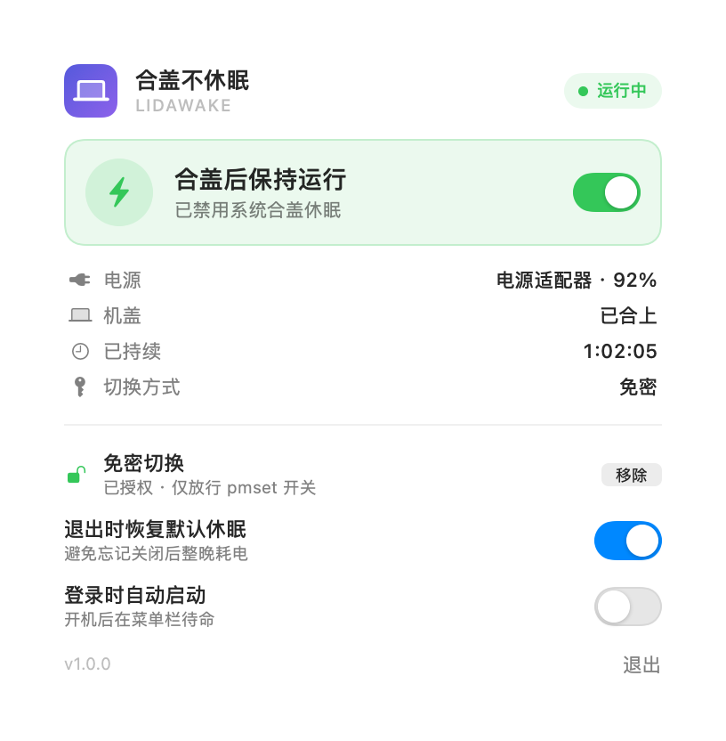
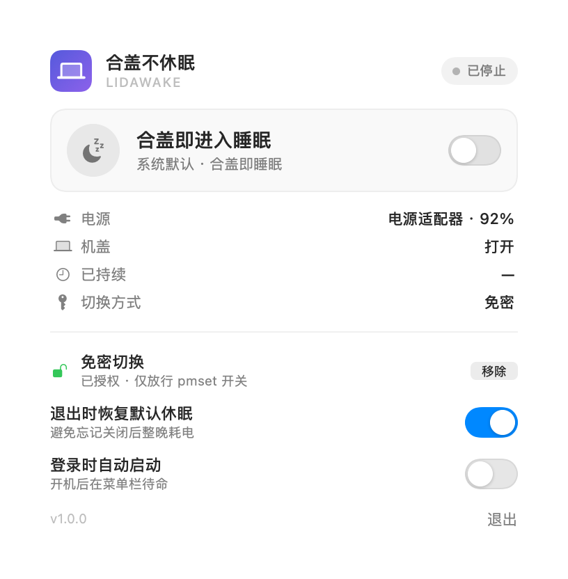
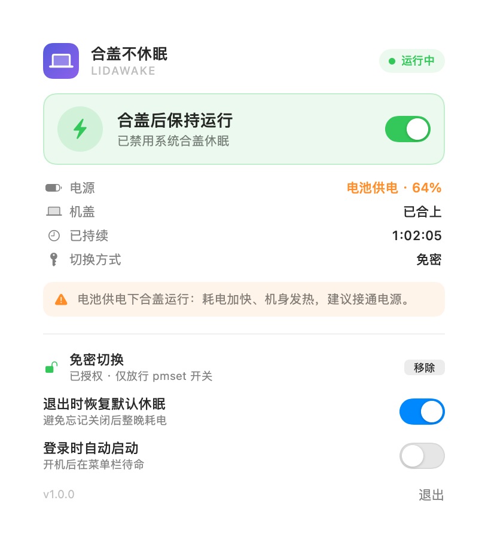

# LidAwake · 合盖不休眠

[](https://www.apple.com/macos/)
[](https://swift.org)
[](LICENSE)

一个常驻菜单栏的小工具：**不外接显示器，合上盖子也让 Mac 继续跑任务**。
效果等价于在终端执行 `sudo pmset -a disablesleep 1`（关闭时写回 `0`），但不用记命令、不用留着终端窗口，退出时还会自动帮你恢复。



## 为什么需要它

macOS 默认合盖就睡。跑编译、渲染、大文件下载、远程任务时，人一走开合上盖子，任务也跟着睡了。
网上流传的做法是 `sudo pmset -a disablesleep 1`，但每次都要开终端敲密码，还很容易忘记改回去——第二天发现机器烫手、电也耗光了。

LidAwake 把它做成一个开关，并且默认「退出应用时自动恢复系统休眠」。

## 安装

**方式一：下载 Release**（推荐）

到 [Releases](../../releases) 下载 `LidAwake-1.0.0.zip`，解压后把 `LidAwake.app` 拖进「应用程序」，双击运行。

> App 使用 ad-hoc 签名（没有 Apple 开发者证书），从网络下载后首次打开会被 Gatekeeper 拦一下：
> 右键点 App →「打开」，或到「系统设置 → 隐私与安全性」点「仍要打开」。之后不再询问。

**方式二：自己构建**

```bash
git clone https://github.com/ThecangShengdance/LidAwake.git
cd LidAwake
./build.sh          # 产物：Dist/LidAwake.app
```

需要 macOS 14+、Xcode 15+（本项目在 macOS 27.2 / Xcode 27.2 上开发验证）。也可以直接用 Xcode 打开 `LidAwake.xcodeproj` 运行。

## 使用

1. 菜单栏出现笔记本图标，点它弹出面板。
2. 拨动顶部开关：
   - **开启** → 合盖后系统不睡眠，继续跑编译 / 下载 / 渲染；
   - **关闭** → 恢复系统默认（合盖即睡眠）。
3. 第一次切换会弹系统管理员授权框（支持触控 ID）。

不想每次都输密码？点面板里的「**授权**」，写入一条**只允许这两条命令**的免密规则：

```
<你的用户名> ALL=(root) NOPASSWD: /usr/bin/pmset -a disablesleep 0, /usr/bin/pmset -a disablesleep 1
```

规则位于 `/etc/sudoers.d/lidawake`，只放行 `pmset -a disablesleep 0|1`，**不会**给出整机 root 权限，随时点「移除」即可删除。
安装流程是「写临时文件 → `visudo -cf` 校验 → 原子替换」，因此不会把 `/etc/sudoers` 写坏导致 sudo 整体失效。

想先审查再授权？`--print-script` 会把规则、安装脚本和 AppleScript 源码原样打印出来。

## 面板上的信息

| 项目 | 含义 |
| --- | --- |
| 电源 | 当前是电源适配器还是电池、电量、是否在充电 |
| 机盖 | 从 IOKit（`AppleClamshellState`）读取的实时开合状态 |
| 已持续 | 本次开启已运行多久 |
| 切换方式 | 「免密」＝已装规则；「需密码」＝每次弹授权框 |
| 电池提醒 | 用电池时合盖运行会明显掉电、机身发热，建议插电 |

两个偏好开关：

- **退出时恢复默认休眠**（默认开）：退出 App 时自动 `disablesleep 0`，避免忘关后整夜耗电。若没装免密规则，退出时会问你是「恢复并退出 / 保持开启退出 / 取消」。
- **登录时自动启动**：开机后直接在菜单栏待命（走 `SMAppService`，需要 App 在「应用程序」里）。

<p align="center">
  
  
</p>

## 安全说明

- 只做一件事：读写 `pmset` 的 `disablesleep` 开关。不联网、不收集任何数据、没有后台服务。
- 提权只有两条通道：受限 sudoers 规则（可选，可一键移除）或系统管理员授权框。
- 不安装 launchd 守护进程，不修改系统文件，不注入进程。

## 原理

- 开关写的是 `pmset -a disablesleep`（macOS 的大杀器：全系统禁用睡眠，合盖也不睡）。
- 提权两条通道：装过免密规则就走 `sudo -n`（静默）；否则走 `osascript ... with administrator privileges` 弹系统授权框。
- sudoers 安装流程：写临时文件 → `visudo -cf` 校验 → `mv -f` 原子替换，避免写坏 `/etc/sudoers` 把 sudo 弄坏。
- 需要 root 的操作都不在主线程执行，面板上会显示「处理中」。

## 目录结构

```
LidAwake/
├── LidAwake.xcodeproj/
├── Sources/
│   ├── App/         LidAwakeApp（MenuBarExtra + 退出恢复）、AppModel（状态机）、CommandLineSupport（自检命令）
│   ├── Core/        Shell（子进程）、Privileged（sudo / osascript 双通道 + sudoers 安装）、SystemStatus（pmset 与 IOKit 读取）
│   ├── Views/       PanelView（368pt 面板 + 自绘开关）
│   └── Resources/   Assets.xcassets（AppIcon）
├── scripts/make_icon.swift   生成 App 图标（改配色/图形后重跑）
├── Docs/                     面板截图
├── build.sh                  构建 + 打包到 Dist/
└── README.md
```

## 调试用命令行

```bash
Dist/LidAwake.app/Contents/MacOS/LidAwake --probe           # 打印系统状态与 pmset 原文
Dist/LidAwake.app/Contents/MacOS/LidAwake --status          # 自检：菜单栏图标是否创建成功
Dist/LidAwake.app/Contents/MacOS/LidAwake --print-script    # 打印免密规则 / 安装脚本 / AppleScript 源码，可自行审计
Dist/LidAwake.app/Contents/MacOS/LidAwake --snapshot out.png --state on --battery
```

## 已知限制

- ad-hoc 签名、未公证，分发到其他 Mac 需要手动放行。
- `disablesleep=1` 期间机器不会自动休眠，**请接电源**；忘记关会持续耗电、机身发热。
- 系统大版本升级后若 `pmset` 行为变化，面板会提示「无法读取系统休眠设置」。
- 暂不支持「按计划自动关闭」「接电源时自动开启」等更复杂的策略。

## License

[MIT](LICENSE)
